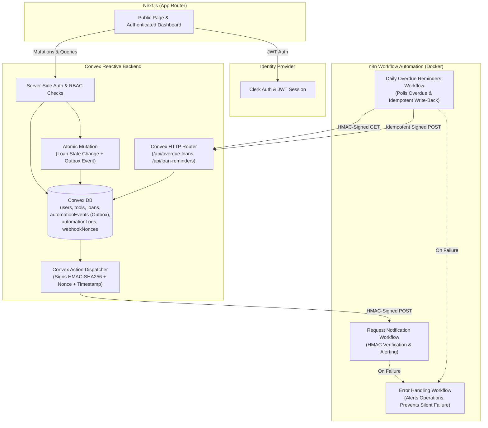

# LendLoop 🔄

> **"Borrow what you need. Lend what you don't."**  
> A multi-user resource-sharing platform built around secure ownership boundaries, transactional loan management, and event-driven automation.

LendLoop allows neighbors to share tools, reserve equipment, track availability in real time, and receive automated notifications and overdue reminders powered by **n8n**. The architecture strictly decouples identity, authorization, transactional business logic, and external workflow execution to ensure predictable behavior and recoverability across network boundaries.

---

## 🛠️ Tech Stack

- **Frontend & App Framework**: [Next.js](https://nextjs.org) (App Router, React 19, Tailwind CSS)
- **Authentication**: [Clerk](https://clerk.com) (JWT-based session authentication)
- **Backend & Real-time Database**: [Convex](https://convex.dev) (Reactive data layer, transactional mutations, outbox dispatcher)
- **Workflow Automation**: [n8n](https://n8n.io) (Self-hosted via Docker Compose or n8n Cloud)
- **Type Safety**: TypeScript 5+ with strict mode and zero implicit `any`

---

## 🏛️ System Architecture & Event-Driven Outbox



### The Transactional Outbox Pattern
Directly invoking third-party webhooks inside database transactions introduces distributed failure modes: the database transaction can commit while the external webhook fails.
LendLoop solves this via the **Transactional Outbox Pattern**:
1. **Atomic Mutation**: Every loan lifecycle transition (`createRequest`, `approveRequest`, `declineRequest`, `confirmReturn`) atomically commits the loan state and writes a pending event record to the `automationEvents` table in a single database transaction.
2. **Resilient Dispatcher**: A Convex action (`convex/outbox.ts`) polls pending events, computes an HMAC-SHA256 signature with nonce and timestamp, dispatches the HTTP payload to n8n, and tracks retry counts.
3. **Idempotent Write-Back**: When n8n executes reminders or status logs, it writes back to Convex using stable composite deduplication keys (`overdue:${loanId}:${date}`), ensuring network retries never generate duplicate notifications or duplicate database logs.

---

## 🔒 Security & Data-Minimization Decisions

| Security Area | Implementation Decision | Engineering Rationale |
| :--- | :--- | :--- |
| **Authentication** | Clerk JWT session verification in Convex (`ctx.auth.getUserIdentity()`) | Prevents spoofed client sessions; identity is verified cryptographically on every backend invocation. |
| **Non-Escalatable RBAC** | Admin roles provisioned via trusted server configuration (`ADMIN_EMAILS`) | Eliminates client privilege escalation vectors. A client cannot pass `role: "admin"` to grant itself permissions. |
| **Authoritative Ownership** | `ownerId`, `borrowerId`, and `lenderId` reference internal `users` records | Avoids fragile replicated user snapshots. Names and emails are resolved server-side from verified sessions. |
| **Data Minimization** | Public queries expose only `{ _id, name, category, condition }` | Anonymous visitors can preview available equipment, but zero owner identities, phone numbers, or emails are exposed. |
| **Derived Availability** | Availability is derived dynamically against active approved loan schedules | Prevents boolean synchronization bugs where `isAvailable` drifts out of sync with actual reservation dates. |
| **Webhook Integrity** | Mutual HMAC-SHA256 signature verification with timestamps and unique nonces | Protects against payload tampering and replay attacks. Note: HTTPS provides transport confidentiality; HMAC provides message authenticity. |
| **Replay Protection** | Rejects timestamps older than 5 minutes and duplicate nonces stored in `webhookNonces` | Ensures an attacker intercepting a valid signed request cannot replay it at a later time. |
| **Idempotency** | Indexed composite deduplication keys (`deduplicationKey: "overdue:${loanId}:${date}"`) | Guarantees that automated daily workflows running with retries cannot send multiple repeat reminders on the same day. |

---

## 📋 Role-Based Access Control (RBAC) Rules

LendLoop enforces two distinct roles at the database layer (not just in UI components):

### 👑 Administrator (`admin`)
- Can remove any tool listing in the neighborhood (moderation).
- Can inspect all active and historical loans across the entire community.
- Can designate community members as **"Trusted Lenders"** (granting verified credibility badges on their listings).

### 👤 Neighbor (`user`)
- Can create, edit, and archive **only their own** tool listings.
- Cannot borrow their own tool (`borrowerId !== lenderId`).
- Only the tool owner can **approve** or **decline** borrow requests.
- Overlapping approved loans on the same tool are strictly rejected.
- Only the tool owner (lender) can confirm the tool has been **returned**.
- Can cancel their own pending borrow requests.

---

## 📂 Project Structure

```
lendloop/
├── app/
│   ├── page.tsx            # Public landing page (read-only available tools directory)
│   ├── dashboard/page.tsx  # Authenticated equipment browser with search & category filters
│   ├── listings/page.tsx   # "My listings" management (create, edit, archive tools)
│   ├── requests/page.tsx   # "My requests" & "Incoming requests" with lifecycle actions
│   ├── admin/page.tsx      # Admin governance panel (trusted lenders, moderation, master ledger)
│   └── layout.tsx          # Root layout with Clerk, Convex providers, and Navbar
├── components/
│   ├── Navbar.tsx          # Responsive navigation bar with role badges
│   ├── ToolCard.tsx        # Tool card with live derived availability indicator
│   ├── RequestModal.tsx    # Date range picker & loan request submission
│   ├── ToolFormModal.tsx   # Form modal to list or edit equipment
│   ├── AutomationHistoryBadge.tsx # Recent n8n automation activity indicator (Bonus)
│   └── ConvexClientProvider.tsx   # Clerk + Convex integration provider
├── convex/
│   ├── schema.ts           # Database schema (users, tools, loans, outbox, logs, nonces)
│   ├── users.ts            # RBAC and server-side identity synchronization
│   ├── tools.ts            # Public data-minimized queries and owner mutations
│   ├── loans.ts            # Loan state machine with overlap detection & outbox commits
│   ├── outbox.ts           # Resilient outbox dispatcher action with HMAC signing
│   ├── automations.ts      # Idempotent write-back mutations and audit history
│   ├── crypto.ts           # Web Crypto HMAC-SHA256 and replay verification helpers
│   ├── nonces.ts           # Nonce registry for replay protection
│   └── http.ts             # Convex HTTP Router (/api/overdue-loans, /api/loan-reminders)
├── workflows/
│   ├── request-notification.json # n8n workflow for loan request status notifications
│   ├── overdue-reminders.json    # n8n daily scheduled workflow for overdue loan alerts
│   └── error-handler.json        # n8n error handling and alerting workflow
├── tests/
│   ├── auth-rbac.test.ts         # Unit & negative tests for RBAC and loan invariants
│   └── hmac-idempotency.test.ts  # Cryptographic tests for HMAC, replay, and idempotency
├── docker-compose.yml       # Self-hosted n8n container definition
├── proxy.ts                 # Next.js 16 Proxy configuration (Clerk route protection)
├── .env.example             # Documented environment variable template
└── README.md
```

---

## 🚀 Getting Started

### 1. Prerequisites
- [Node.js](https://nodejs.org) (v18.17+ or v20+)
- [Docker & Docker Compose](https://www.docker.com/) (for self-hosting n8n)

### 2. Clone and Install Dependencies
```bash
git clone https://github.com/your-username/lendloop.git
cd lendloop
npm install
```

### 3. Configure Environment Variables
Copy the template to `.env.local`:
```bash
cp .env.example .env.local
```
Fill in your credentials:
```env
NEXT_PUBLIC_CLERK_PUBLISHABLE_KEY=pk_test_...
CLERK_SECRET_KEY=sk_test_...

NEXT_PUBLIC_CONVEX_URL=https://your-convex-deployment.convex.cloud
CONVEX_DEPLOYMENT=dev:your-convex-deployment
NEXT_PUBLIC_SITE_URL=https://your-lendloop-site.example

ADMIN_EMAILS=admin@lendloop.org

WEBHOOK_SECRET=your-shared-hmac-secret-string
N8N_WEBHOOK_URL=http://localhost:5678/webhook/lendloop-request
```
`NEXT_PUBLIC_SITE_URL` is used for absolute links in `sitemap.xml`. If omitted,
the sitemap uses Vercel's deployment URL when available and `http://localhost:3000`
for local development.

For the production Vercel deployment, add this environment variable to the
Vercel project's **Production** environment and redeploy:

```env
NEXT_PUBLIC_CLERK_PROXY_URL=https://lendloop-lime.vercel.app/__clerk
```

The Clerk middleware explicitly enables its frontend API proxy at `/__clerk`,
so this setting works without DNS changes to the `vercel.app` domain.

### 4. Start Convex Backend
In a separate terminal:
```bash
npx convex dev
```

### 5. Start n8n Workflow Automation
Launch the self-hosted n8n instance:
```bash
docker compose up -d
```
Open **[http://localhost:5678](http://localhost:5678)** in your browser:
- Log in with the credentials specified in `docker-compose.yml` (`admin` / `lendloopsecret123`).
- In n8n, click **Import from File** and import the workflow JSON files from the `workflows/` directory:
  1. `workflows/request-notification.json`
  2. `workflows/overdue-reminders.json`
  3. `workflows/error-handler.json`
- Activate the workflows.

### 6. Run the Next.js Development Server
```bash
npm run dev
```
Open **[http://localhost:3000](http://localhost:3000)** to view LendLoop.

---

## 🧪 Automated Test Suite

LendLoop includes a production test suite covering authorization, loan state transitions, negative security cases, cryptographic integrity, and idempotency:

```bash
npm test
```

### Test Coverage Highlights:
- **Negative Security**: Confirms normal users cannot escalate their role to `admin` via client arguments.
- **Ownership Boundaries**: Verifies non-owners cannot edit or delete another user's listings.
- **Loan Invariants**: Proves users cannot borrow their own tools, and overlapping approved loans are strictly rejected.
- **Cryptographic Tamper-Proofing**: Validates HMAC-SHA256 signatures, rejects tampered payloads, and enforces constant-time string comparisons.
- **Replay Attack Prevention**: Rejects stale timestamps (> 5 minutes drift) and duplicate nonces.
- **Idempotent Write-Back**: Verifies that network retries with identical deduplication keys skip without creating duplicate reminder logs.

---

## 🚢 What Would Change for Production Deployment

To run LendLoop at commercial scale in production, the following enhancements should be introduced:

1. **Hardware Security / Secrets Management**:
   - Replace static environment variables for `WEBHOOK_SECRET` with AWS Secrets Manager, HashiCorp Vault, or Google Secret Manager.
   - Implement automated HMAC key rotation with a dual-key grace period (verifying signatures with current or previous active secret).
2. **Dedicated Distributed Message Broker**:
   - In ultra-high-throughput environments, replace the polling outbox with a managed event stream (e.g. AWS SQS, Apache Kafka, or Upstash QStash) to handle spikes with guaranteed FIFO ordering.
3. **Dead-Letter Queues (DLQ) & Alerting**:
   - Route events that fail 5 consecutive retries to a permanent DLQ table.
   - Wire the n8n error workflow into PagerDuty, Opsgenie, or a dedicated Slack/Discord operations channel for real-time alerts.
4. **Production Email / SMS Integration**:
   - In n8n, swap the demonstration notification nodes for direct transactional providers (Resend, SendGrid, or Twilio) with template management and bounce handling.
5. **Network Ingress & IP Whitelisting**:
   - Place n8n behind a reverse proxy (e.g. Cloudflare / Nginx) with mutual TLS (mTLS) or restrict the `/api/overdue-loans` and `/api/loan-reminders` endpoints to n8n's static egress IP.
